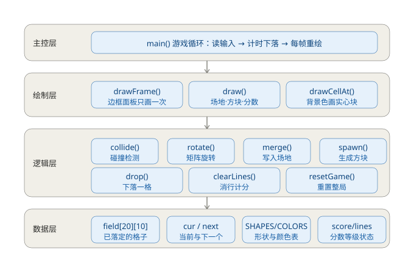
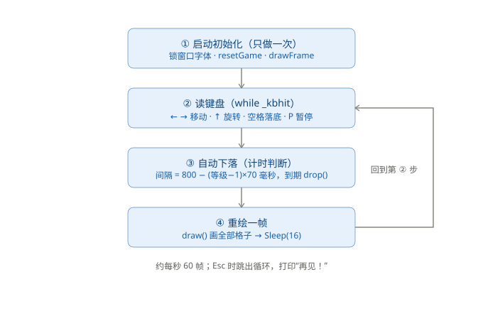
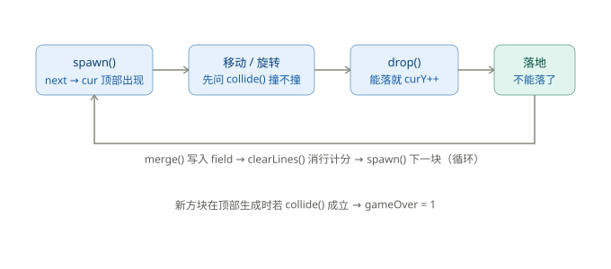

# 俄罗斯方块代码讲解

> 对应源码：`tetris.c`（控制台版，纯 C，Visual Studio 可直接编译运行）
> 操作：← → 移动，↑ 旋转，↓ 加速，空格 落底，P 暂停，R 重开，Esc 退出

---

## 一、整体骨架：四层结构

这份代码 500 行不到，核心思路可以拆成四层——**数据 → 逻辑 → 绘制 → 主控**，上层调用下层：



四层各管一件事：

- **数据层**就是几个全局变量。`field[20][10]` 存已经落定不动的格子（0 空、1~7 代表方块种类）；`cur`/`next` 是 4×4 矩阵，1 表示该位置有方块；`SHAPES` 是 7 种方块的 0/1 模板，`COLORS` 是对应颜色。
- **逻辑层**全部围绕 `collide()` 这个“裁判”：任何移动、旋转、下落，先问一句“放到这个位置会不会撞墙/撞到已有方块”，会就不许动——这就是方块永不越界的秘密。
- **绘制层**把数据翻译成屏幕上的字符；**主控层** `main()` 负责把它们串起来。

---

## 二、程序跑起来后，每一帧都在重复三件事



`main` 先做一次性初始化（锁定控制台窗口和字体、清零场地、画好边框），然后进入 `while(1)` 无限循环：读键盘 → 计时下落 → 重绘 → `Sleep(16)`，约每秒 60 帧。按 Esc 跳出循环，打印“再见！”。

---

## 三、一个方块的一生



`spawn → 移动/旋转 → 下落 → 落地结算` 这条主链一直循环，直到新方块在顶部生成时就撞堆（`collide()` 成立），游戏结束。

---

## 四、主要代码摘录

### 1. 核心数据（整个游戏就是这几个变量）

```c
#define FIELD_W 10  #define FIELD_H 20   /* 场地 10×20 */
static int field[FIELD_H][FIELD_W];  /* 已落定的格子：0 空，1~7 方块种类 */
static int cur[4][4], next[4][4];    /* 当前方块、下一个方块（4×4 矩阵） */
static int curX, curY;               /* 当前方块左上角在场地的坐标 */
static const int SHAPES[7][4][4] = { /* 7 种方块的 0/1 形状模板 */ ... };
```

理解关键：`cur` 里 `1` 的地方就是方块。比如 T 形是 `{0,1,0},{1,1,1}`，把它“贴”到场地的 `(curX, curY)` 位置就得到实际占据的格子。

### 2. 裁判函数 `collide()` —— 全程序最重要的 10 行

```c
static int collide(const int s[4][4], int px, int py)
{
    for (i = 0; i < 4; i++)
        for (j = 0; j < 4; j++) {
            if (!s[i][j]) continue;
            int x = px + j, y = py + i;
            if (x < 0 || x >= FIELD_W || y >= FIELD_H) return 1; /* 出界 */
            if (y >= 0 && field[y][x]) return 1;                 /* 撞堆 */
        }
    return 0;
}
```

左移、右移、旋转、下落、生成新方块——**每个动作都先调用它试算**，`collide` 返回 1 就撤销动作。所以方块永远越不过那两道边界判断，这也是“边界不变、方块不出界”的实现位置。`y < 0` 的部分允许在场地顶部之外（方块刚生成时），所以有 `y >= 0` 的保护。

### 3. 落地的连锁反应 `drop()`

```c
if (!collide(cur, curX, curY + 1))  curY++;        /* 还能落 → 继续 */
else { merge(); clearLines(); spawn(); }            /* 落不了 → 固定、消行、下一块 */
```

`clearLines()` 从下往上扫，哪一行 10 格全满就把上面的行整体下移、顶部补空，返回消掉的行数；`spawn()` 把预览区的 `next` 搬到 `cur`，再随机生成新的 `next`，若新方块一出生就撞堆则 `gameOver = 1`。

### 4. 让方块“看得见”的绘制技巧

```c
SetConsoleTextAttribute(hOut, (WORD)((color << 4) & 0xFF));  /* 颜色放高位 = 背景色 */
printf("  ");                                                /* 两个空格 */
```

控制台里空格字符显示的是**背景色**，所以画两个带彩色背景的空格 = 一个 2 列宽的实心色块——不依赖任何特殊字符，永远和 10×20 场地严格对齐。

### 5. 主循环的骨架

```c
fixFont(); lockSize(); disableResize();       /* 锁定窗口和字体，边界不跑偏 */
resetGame(); drawFrame();
while (1) {
    while (_kbhit()) { ch = _getch(); /* 按键处理：移动/旋转/落底/暂停/重开 */ }
    if (到期 && !gameOver && !paused) drop(); /* 自动下落，速度随等级加快 */
    draw();  Sleep(16);                       /* 每帧重绘，约 60 FPS */
}
```

---

## 五、一句话总结

`main` 初始化后进入无限循环，每帧先处理按键（改 `curX`/`curY` 或旋转 `cur`，全部经过 `collide` 把关），再按计时调用 `drop()` 让方块下落，最后 `draw()` 把 `field + cur + next` 全部重画一遍。

想改玩法，优先改这三处——它们是程序的“心脏”：

| 想改什么 | 改哪里 |
| --- | --- |
| 方块形状 | `SHAPES` 表 |
| 游戏规则/边界 | `collide()` |
| 计分/消行 | `drop()` 与 `clearLines()` |
