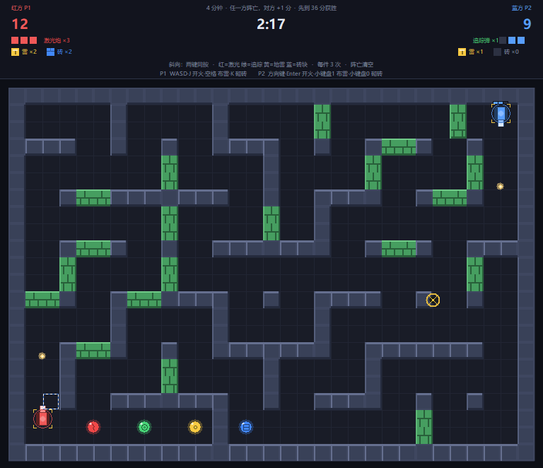

# 坦克大战 · 双人对战 Demo（C / Win32 GDI）

一个可直接运行的坦克对战 demo：**2 格宽通道**的迷宫地图、双人同屏对战、**任意角度转向**、
炮弹撞墙反弹、绿色砖墙可打穿、四种彩色道具、4 分钟计时赛，
另外支持**局域网 TCP 双人联机**（一台做主机、一台加入）。
所有带伤害的东西**不分敌我**——自己的炮弹、激光、追踪弹、地雷照样能把自己送走。
纯 C 编写，只依赖 Windows 自带的 `user32.dll` / `gdi32.dll` / `ws2_32.dll`（联网用），无第三方库。



## 运行

启动后先弹出**模式选择窗口**（本地双人 / 创建房间 / 加入房间 / 退出），选完才进入游戏。

- **直接玩**：双击 `TankBattle.exe`
- **在 Visual Studio 里开发**：双击 `TankBattle.sln`，按 `F5`
- **命令行编译**：双击 `build.bat`，或
  ```
  cl /utf-8 /O2 main.c user32.lib gdi32.lib ws2_32.lib
  ```
  联机功能用到 Winsock，编译时必须链接 `ws2_32.lib`（`build.bat` 和 VS 工程都已加好）。

> 工程使用 v145 工具集（VS 2026）。若是 VS 2019 / 2022，右键项目 → 属性 → 平台工具集，改成 v142 / v143 即可。

## 操作

| 玩家 | 移动 / 转向 | 开火 | 放地雷 | 砌砖块 |
|------|------|------|------|------|
| P1 红方 | `W` `A` `S` `D` | `J` | **空格** | **`K`** |
| P2 蓝方 | `↑` `↓` `←` `→` | `Enter` | **小键盘 `1`** | **小键盘 `0`** |

本地模式：`R` 重开一局，`Esc` 退出程序。联机模式的 `R` / `Esc` 见下一节。

> **P2 开火为什么只有一个键**：小键盘 `0` 原来也是开火键，现在按需求让给了"蓝砖"，
> 同一个键不能既开炮又砌墙，所以 P2 开火保留 `Enter`。
>
> **小键盘需要 NumLock 亮着**（灭了会报成 `End` / `Insert`）。代码里把这两种码都收下了，
> 所以 NumLock 开关都无所谓；但笔记本如果没有独立数字键盘，P2 就只能开火、放不了东西。
> P1 的埋雷键放空格，是拇指最顺手的位置，也不和 `WASD` / `J` 抢。

**转向是有角度的**：车头方向不是只有上下左右四档，而是连续的角度。

- 单按 `W` → 车头朝上；单按 `D` → 朝右
- **`W` + `A` 一起按 → 车头转到左上方 45°，并且真的斜着开**
- 任意两键组合都行（45° / 135° / 225° / 315°），松手就保持当前朝向
- 转向有角速度上限（`TANK_TURN`），所以能看到车体平滑地"打方向"：
  车头还没对准目标时走得慢（差 90° 时速度为 0，等于原地转），对准了才全速

> 上表是**本地双人**的键位。联机模式下双方都用 P1 的键位，见下一节。

## 局域网双人联机

启动时在模式选择窗口里二选一：**创建房间**（当主机）或**加入房间**（当客户端）。
两台电脑需要在同一个局域网里（同一 WiFi / 同一路由器），用 TCP 直连。

### 创建房间（主机，红方 P1）

菜单里端口默认填好 **27515**，点"开始创建"后主窗口显示三项信息：

- **本机 IPv4**（程序自动探测，例如 `192.168.1.23`）
- **端口**（默认 27515，可以自己改）
- **6 位邀请码**（每局随机，用来防止连错房间）

把这三项告诉对方，然后等待对方加入。

### 加入房间（客户端，蓝方 P2）

在"加入房间"页输入对方告诉你的三项：**主机 IP、端口、邀请码**，点"连接并加入"。

### 联机怎么玩

| 项目 | 说明 |
|------|------|
| 阵营 | **主机固定红方 P1，客户端固定蓝方 P2**，不能换边 |
| 键位 | **双方都用 P1 的键位**：`WASD` 移动、`J` 开火、空格放雷、`K` 砌砖，各开各的坦克 |
| 开始 | 大厅里**双方都按 `R` 准备**，都准备好后自动开始 |
| 重赛 | 一局结算后，双方再按 `R` 准备，即可重赛 |
| 退出 | 联机中按 `Esc` 返回模式选择 |
| 断线 | 一方掉线 / 超时 / 退出，双方都会收到提示并回到模式选择；**不支持中途重连**，想再战就重新建房 |

规则、道具和本地双人完全一样：还是 4 分钟、先到 36 分获胜、伤害不分敌我。

### 几个技术说明（玩之前值得看一眼）

- **主机权威同步**：只有主机跑完整的游戏逻辑，客户端只上报自己的按键、
  然后显示主机算出来的画面（全量快照）。没有客户端预测，所以操作手感会带
  一点点网络延迟，局域网内通常察觉不到。
- **只支持可信局域网**：通信不加密、不做 NAT 穿透，两台机器必须能直接 IP 互通。
  不要把它暴露到公网上。
- **Windows 防火墙**：第一次创建房间时系统会弹防火墙询问，务必勾选**允许"专用网络"**，
  否则对方会一直连不上。

## 比赛规则

| 项目 | 规则 |
|------|------|
| 一局时长 | **4 分钟**（HUD 中央倒计时，最后 30 秒变红） |
| 得分方式 | **任意一方阵亡，另一方就 +1 分**（打中不掉分，只有阵亡才计分） |
| 提前获胜 | 任意一方先到 **36 分**，立即结束 |
| 时间到 | 分数高的一方获胜；**同分则平局** |
| 复活 | 双方可无限复活（死亡 1.2 秒后回出生点，带 1.5 秒无敌护盾） |

计分只看"谁死了"，不看"谁开的火"：

```
P1 被 P2 打死        → P2 +1
P1 被自己的子弹打死   → P2 +1   （自己作死，对手收分）
P1 踩到自己的地雷炸死 → P2 +1
P1、P2 同时被一颗雷炸死 → 各 +1（互相送分）
```

## 伤害规则：不分敌我

任何带伤害的东西，**碰到谁谁掉血**，没有友军保护：

| 弹药 | 伤害 | 会不会伤到自己 |
|------|------|------|
| 普通炮弹 | 1 | 会。撞墙弹回来正好打中自己，照扣（出膛 0.08 秒内除外，见下） |
| 折射激光 | 2 | 会。光束折返扫到自己，一样 2 点 |
| 追踪弹爆炸 | 2 | 会。贴脸放追踪弹，爆炸半径内的自己也被炸 |
| 地雷 | 2 | 会。走开再走回来踩到自己的雷，照炸（见下） |

为什么炮弹有个"0.08 秒"的例外：子弹生成在炮口（离车心 12px），恰好等于命中判定阈值，
不设保护的话**每次开炮都会自伤**，所以出膛瞬间不结算自伤；0.08 秒后子弹已飞出 24px，之后连自己的炮都能打。

## 四种道具（彩色小球）

场上每 6~10 秒随机刷一个小球，最多同时存在 4 个，20 秒不捡就消失（最后 3 秒闪烁）。
小球只会刷在地面格上，并且刻意避开双方身边 56 像素内，不会"贴脸掉"。

| 颜色 | 道具 | 拿到之后 | 说明 |
|------|------|------|------|
| 🔴 红 | **折射激光炮** | 手里换装，**3 次** | 瞬发光束，撞钢墙按分量折射（**最多 3 次、总路程 620 像素封顶**）；撞砖墙则被吸收、砖掉 1 点血。伤害 2 点，斜着射也能正确折返 |
| 🟢 绿 | **追踪弹** | 手里换装，**3 次** | 发射后先**瞄准 1.4 秒**（敌人头上出现收缩的虚线准星 + 指向线，这就是躲避窗口），时间到锁定敌人**那一刻**的位置，然后穿过所有迷宫墙壁飞向该点爆炸，范围伤害 2 点 |
| 🟡 黄 | **地雷** | 存起来，**最多 2 个** | 按放置键在**自己脚下**埋一颗：**埋下的瞬间是显型的**（黄圈 + 雷体 + 四根刺，亮 0.9 秒后淡出），之后**完全隐形**。0.8 秒布防，布防结束时自己还站在上面不会被炸，但**走开再走回来照样炸自己**（伤害 2 点、爆炸半径 26px）。同一处不会叠两颗 |
| 🔵 蓝 | **砖块** | 存起来，**最多 2 个** | 按放置键在**车头正前方一格**砌一块砖：和地图上的绿色砖墙完全一样，4 点血、能被打穿。用来堵路口、做掩体、封通道；砌完会把车轻轻顶开一点，不会把自己埋进去 |

球的中间还有小符号（闪电 / 准星 / 圆点 / 方框），色弱也能区分。

### 持有规则（这一版的重点）

| 规则 | 说明 |
|------|------|
| 一件道具 = **3 次** | 拾到红/绿就换成对应武器、给满 3 次；打光自动退回普通弹 |
| **新道具顶掉旧道具** | 手里已经有武器时再拾另一个，旧武器连同剩余次数**直接作废**。所以还剩 3 次时去捡是亏的，剩 1 次时去捡是赚的 |
| 黄、蓝不被顶掉 | 这两种是"存货"，拾到红/绿不会把它们冲掉，可以一直攒着 |
| 黄、蓝各存 **2 个** | 攒满后再踩到同色球**不会捡起来**（球留在原地等下一趟），不会白扔 |
| **阵亡全部清空** | 死一次，武器、剩余次数、地雷、砖块**全部归零**，重生后从空手开始 —— 攒着不用是有代价的 |

HUD 里血量方块**正下方**就是这两个槽位：黄点 `雷 ×N`、蓝点 `砖 ×N`，
数量为 0 时整条变暗，扫一眼就知道自己手里还有没有东西可放。

放置前会先画预览：脚下是**黄色四角括号**表示"按空格会在这里埋雷"；
车头前一格是**蓝色虚线方框**表示"按砌砖键（P1 `K` / P2 小键盘 `0`）会在这里砌砖"，放不下时方框变红。

## 其他已实现的机制

- **更大的迷宫**：31 × 22 格（每格 24px），由 10 × 7 = 70 个 2×2 的房间组成、房间之间隔 1 格墙，
  所以**所有通道都是 2 格宽（48px）**——18px 的车体可以斜着进出拐角，不会卡住。
  生成方式是"随机生成树 + 额外打通环路"，所以既有绕远的死路，也有多条捷径；
  剩下的一部分隔墙直接换成了砖墙 —— 这些是"软路"，打穿能抄近道。
  地图做过校验：**432 格地面全部连通、没有 1 格宽的窄道**（每一格都属于某个 2×2 的空地方块）
- **两种墙**：灰色钢墙 `#` 打不烂；绿色砖墙 `B` 有 4 点血，打 4 发就变成能通行的地面（砖面会随血量变暗、裂纹从 1 道涨到 3 道，一眼能看出还剩多少血）
- **坦克移动**：X / Y 轴分离检测，贴着墙可以滑行，但永远进不了墙里，也出不了场地边界；
  因为位移是按"车头方向"算的，所以斜向移动同样会被墙正确挡下
- **炮弹反弹**：撞钢墙时按 X / Y 轴分别反射，最多反弹 5 次后消失；撞上砖墙则打进墙里、消耗掉
- **其他**：每方同时最多 3 发普通弹、0.34 秒开火冷却、击中火花、双缓冲无闪烁

## 想改东西改哪里

| 需求 | 位置 |
|------|------|
| 改地图 | `main.c` 顶部 `g_mapInit[]`，`#` 钢墙、`B` 砖墙、`.` 地面，每行必须 31 个字符、共 22 行 |
| 砖墙血量 | `BRICK_HP`（默认 4） |
| 一局时长 / 获胜分 | `ROUND_TIME`（默认 240 秒）/ `WIN_SCORE`（默认 36） |
| 改场地大小 | `MAP_W` / `MAP_H` / `TILE`（改了地图行数要一起改） |
| 一件道具给几次 | `ITEM_USES`（默认 3） |
| 雷 / 砖最多存几个 | `MAX_SLOT`（默认 2） |
| 道具刷新频率 / 存在时间 | `ITEM_SPAWN` / `ITEM_LIFE` / `MAX_ITEMS` |
| 车速 / 转向快慢 | `TANK_SPEED` / **`TANK_TURN`**（弧度/秒，默认 8 ≈ 每 0.2 秒转 90°） |
| 改弹速 / 反弹次数 | `BULLET_SPEED` / `MAX_BOUNCE` |
| 激光射程 / 折射次数 / 伤害 | `LASER_RANGE` / `LASER_BOUNCE` / `LASER_DMG` |
| 追踪弹瞄准时间 | `MISSILE_AIM`（调大更容易躲）、`MISSILE_SPEED`、`MISSILE_RADIUS` |
| 地雷触发半径 / 伤害 / 是否炸自己 | `MINE_TRIGGER` / `MINE_DMG` / **`MINE_FRIENDLY`**（改成 0 就退回"只炸敌人"） |
| 改配色 | `C_*` 一组宏（砖墙 `C_BRICK*`，道具 `C_ITEM_*`） |
| 关掉反弹 | 把 `MAX_BOUNCE` 改成 0 |
| 关掉自伤 | `BulletHitCheck` 里把 `if (j == b->owner && b->grace > 0.0f)` 改成无条件 `continue` |
| 联机断线超时 | `NET_TIMEOUT_MS`（默认 5000 毫秒） |
| 联机卡顿后最多补几帧 | `NET_MAX_TICK_CATCHUP`（默认 8 个 tick） |

调试小技巧：给编译器加 `/DAUTO_DEMO`，两辆车会自动巡逻开火，方便观察碰撞、跳弹和道具效果。

## 后续可以加的功能

随机地图生成、道具图标化（换成贴图）、音效（`PlaySound` / XAudio2）、AI 对手、
把地图存成外部文本文件方便关卡编辑、砖墙被打穿后的碎石堆积、战绩统计、
联机中途重连、互联网对战（NAT 穿透）。
