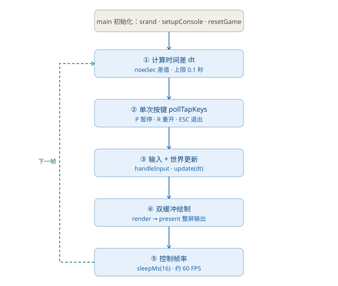
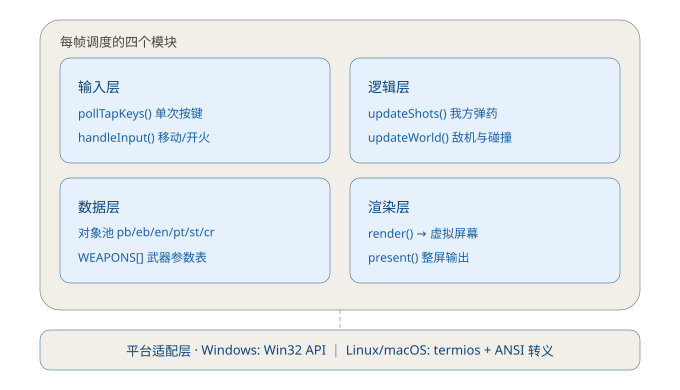
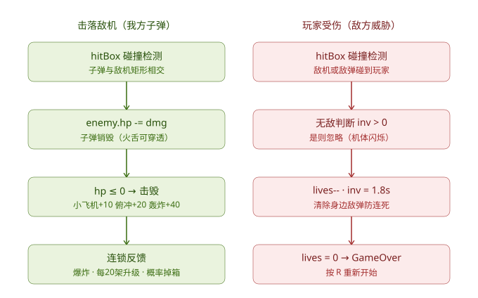

# 雷霆战机（Sky Fighter）代码解析

> 源文件：`ConsoleApplication1(1).cpp`
> 类型：C 语言控制台射击游戏，Windows / Linux 双平台，约 1189 行
> 核心机制：**每帧计算时间差 dt → 读输入 → 更新世界 → 把整屏先画进内存再一次性输出**（双缓冲，约 60 FPS）

---

## 一、程序概览

这是一款在控制台里用字符画出来的纵版射击游戏：敌机从上方压下来，玩家走位、按住空格开火，还能捡战场里飘落的弹药箱切换武器。

| 项目 | 说明 |
| --- | --- |
| 战场 | 56 × 24 格，虚拟屏幕 62 × 27 字符 |
| 操作 | ← → ↑ ↓ 移动，空格开火（按住连射），P 暂停，R 重开，ESC 退出 |
| 武器 | 机炮（无限）、霰弹、喷火、追踪导弹、速射、三向弹 |
| 计分 | 小飞机 +10，俯冲机 +20，轰炸机 +40；每击落 20 架升 1 级 |
| 生命 | 3 条命，受伤后 1.8 秒无敌闪烁 |

---

## 二、主要代码 ① —— 主循环 `main()`

程序的心脏就是这个循环，所有游戏逻辑都由它驱动：

```c
while (!quitGame) {
    now = nowSec();  dt = now - last;  last = now;
    if (dt > 0.1) dt = 0.1;                    // 卡顿保护
    pollTapKeys();                             // P / R / ESC 单次按键
    if (quitGame) break;
    if (!paused && !gameOver) handleInput(dt); // 方向键 + 空格连射
    update(dt);                                // 推进游戏世界
    render();                                  // 绘制整帧
    sleepMs(16);                               // ≈ 60 FPS
}
```

进入循环前依次执行：`srand()` → `setupConsole()` → `resetGame()` → `render()` → `printHelp()`。



### 主循环的三个关键设计

1. **时间驱动，与帧率解耦**：`nowSec()` 在 Windows 用 `QueryPerformanceCounter`，POSIX 用 `clock_gettime`。所有速度都写成 `x += v * dt`（单位：格/秒），掉帧时飞机移动和子弹飞行速度不变；`dt > 0.1` 直接截断，避免切回窗口时物体瞬移穿透。
2. **两种输入方式分工**：方向键和空格用 `GetAsyncKeyState()` 判断"当前是否按住"（连续移动 / 连射）；P、R、ESC 用 `_kbhit()` / `_getch()` 轮询处理单次动作。
3. **双缓冲**：`scrCh[][]` 存字符、`scrCo[][]` 存颜色，每帧 `scClear()` 后把实体逐个 `scPut()` 进内存，最后 `present()` 用 `WriteConsoleOutputA()` 一次性刷到控制台，因此不闪屏。

---

## 三、主要代码 ② —— 状态数据与模块分层

所有实体都用"数组 + `on` 标志位"的对象池管理：

```c
static Enemy  en[MAX_EN];          // 16 架敌机，靠 on 标记占用
static Shot   pb[MAX_PB], eb[MAX_EB];   // 我方 90 发 / 敌方 70 发
static Particle pt[MAX_PT]; static Star st[MAX_STAR]; static Crate cr[MAX_CR];
static char  scrCh[SCR_H][SCR_W];              // 虚拟屏幕：字符
static unsigned char scrCo[SCR_H][SCR_W];      // 虚拟屏幕：颜色
```

`addShot()` / `spawnEnemy()` 找第一个 `on == 0` 的空位复用，死亡只把 `on` 置 0，不频繁申请内存。



代码按职责分成四层：

| 层 | 主要函数 | 职责 |
| --- | --- | --- |
| 输入层 | `pollTapKeys()`、`handleInput()` | 单次按键与连续移动/开火 |
| 逻辑层 | `updateShots()`、`updateWorld()` | 弹药、敌机、碰撞、计时器 |
| 数据层 | 对象池数组、`WEAPONS[]` | 实体状态与武器参数 |
| 渲染层 | `render()`、`present()` | 虚拟屏幕绘制与整屏输出 |
| 平台适配层 | Win32 API / termios + ANSI | 屏蔽操作系统差异 |

---

## 四、主要代码 ③ —— 世界更新与碰撞

一帧里真正"发生事情"的地方是 `update()`：

```c
static void update(double dt) {
    if (gameOver || paused) { /* 只让星星和碎片继续动 */ return; }
    timeNow += dt;
    if (player.inv > 0) player.inv -= dt;      // 无敌倒计时
    /* 星星下落 */
    updateShots(dt);   // 我方弹药：追踪/火焰衰减/命中/计分/升级
    updateWorld(dt);   // 敌机移动开火/敌弹/弹药箱/碎片/生成计时器
}
```

碰撞统一走 `hitBox()` 轴对齐矩形判定。一帧内两组最关键的因果链如下：



---

## 五、其余关键机制

- **武器系统**：`WEAPONS[]` 一张表同时驱动 HUD 显示、射速间隔和弹药数；`shootPlayer()` 用 `switch` 分派六种弹幕（霰弹 5 发扇形、短命火舌、导弹调 `nearestEnemy()` 追踪、速射、三向弹），弹药归零自动退回无限机炮。
- **节奏控制**：`spawnTimer` / `crateTimer` 两个倒计时器控制敌机和弹药箱生成；每击落 20 架 `levelNo++`，敌机速度 `spd = 1 + (level-1)*0.12`，生成间隔同步缩短（下限 0.30 秒）。
- **渲染流水线**：`render()` 按固定顺序作画 —— 清屏 → HUD → 边框 → 星星 → 弹药箱 → 敌机 → 子弹 → 玩家 → 碎片 → 提示框 → `present()`。
- **平台适配**：`nowSec()` / `sleepMs()` / `pollTapKeys()` / `handleInput()` / `present()` / `setupConsole()` 等函数在 `#ifdef _WIN32` 下有两套实现，上层逻辑完全平台无关。

---

## 六、编译与运行

文件后缀虽是 `.cpp`，但代码本身是纯 C。按文件头注释：

```bash
cl /utf-8 shoot.c user32.lib      # MSVC
gcc shoot.c -o shoot.exe -O2      # MinGW
gcc shoot.c -o shoot -O2          # Linux / macOS
```

操作：方向键移动、空格开火、P 暂停、R 重开、ESC 退出；撞到飘落的 `[S]` `[F]` `[H]` `[R]` `[M]` 弹药箱即可换武器。
